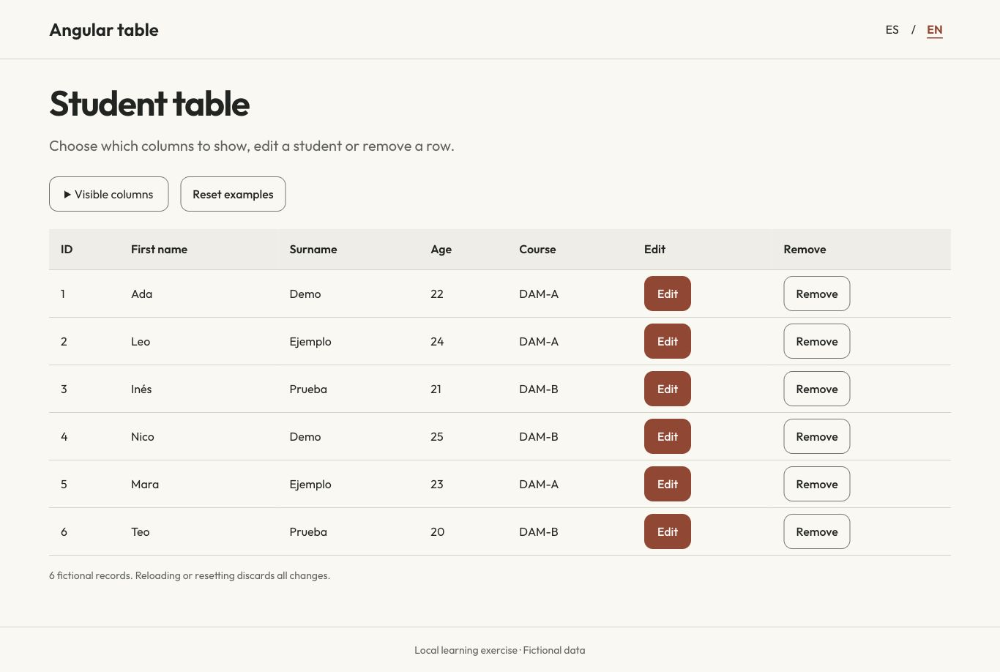
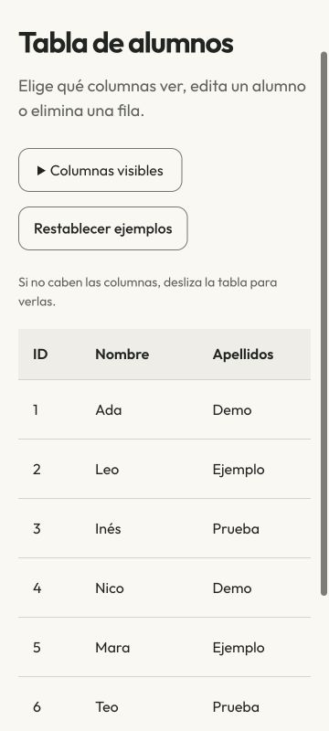
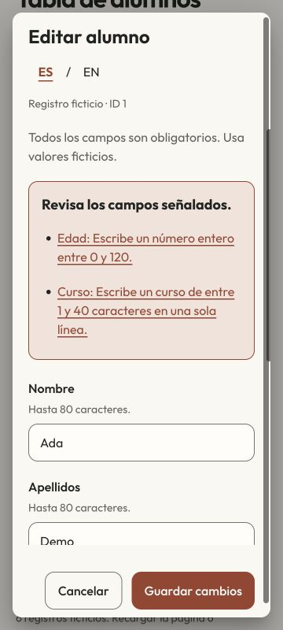

# Student table · Angular

[Español](README.es.md)

An Angular Material exercise for showing and hiding columns, editing a student and removing rows. It starts with six fictional students and runs entirely in memory. Reloading the page starts over; **Reset examples** also restores the six students and discards edits, while keeping your column choices.



## Run it

Use an isolated **Node 14.21.3 / npm 6.14.18** environment to reproduce the checked setup. The project retains Angular CLI 12.2.9 and its original dependency lock. These are historical tools, not a recommended starting point for a new application. See [Angular compatibility](https://angular.dev/reference/versions) and [Node release status](https://nodejs.org/en/about/previous-releases).

```sh
npm ci
npm start -- --host 127.0.0.1
```

Open `http://127.0.0.1:4200/`. Spanish is the initial UI language; select **EN** for English. Switching language preserves the current draft, errors and column choices. No account or API key is needed.

For the production bundle:

```sh
npm run build -- --configuration production --progress=false
python3 -m http.server 8080 --bind 127.0.0.1 --directory dist/my-app
```

Open `http://127.0.0.1:8080/`. The build output is not committed.

## Try the behavior

1. Open **Visible columns**. Hide several columns and show them again in a different order: the table keeps its original column order. The last visible data column cannot be hidden. Edit and Remove columns can be hidden independently.
2. Edit Ada. Names and course are required and length-limited; age must be a whole number between 0 and 120. Invalid saves leave the row unchanged. The error summary links to the fields that need attention.
3. Change language while editing. Save to update the row, or use Cancel/Escape to discard the draft.
4. Remove a student. The confirmation opens with focus on Cancel. After removal, focus returns to the table heading because the triggering row no longer exists.
5. Remove all six students, then reset the examples. Reset also clears edits. Reloading resets data, column choices and language.

The table scrolls horizontally inside its own region on narrow screens. Dialog content scrolls while the action buttons remain available, including in landscape.

<p>


</p>

## Tests and implementation

```sh
npm test -- --watch=false --browsers=ChromeHeadless
```

This uses a local Chrome installation. Alternatively, run the same Jasmine suite with a browser you open manually:

```sh
npm run test:manual
```

Open `http://127.0.0.1:9876/` and keep it open until Karma finishes. Set `TABLE_TEST_PORT` if that port is occupied. The recorded review used this manual browser runner: **24 tests passed**, plus production-bundle browser checks. These are local results, not hosted CI. Details and limitations: [verification](docs/verification.json).

- [Table state](src/app/tabla/tabla.component.ts): ordered column selection, stable row IDs, updates, removal and reset.
- [Editor](src/app/editor/student-editor.component.ts): a separate reactive-form draft; commit only on a valid save.
- [Validators and fixtures](src/app/student.ts): bounded text and integer age checks, fresh fixture objects on reset.
- [Translations](src/app/i18n.service.ts): Spanish resources with English fallback; changing language does not recreate the table or editor.
- [Design decisions](DESIGN.md) and [third-party notices](THIRD_PARTY.md).

There is no backend, authentication or persistent storage. This is a learning exercise, not a school administration system. The review does not establish current dependency security, screen-reader support or production readiness. No new hosted workflow was added. The original CLI notes below are kept as historical documentation; they do not mean an end-to-end test package is installed.

<details>
<summary>Original documentation and credits · Documentación y créditos originales</summary>

# MyApp

This project was generated with [Angular CLI](https://github.com/angular/angular-cli) version 12.2.9.

## Development server

Run `ng serve` for a dev server. Navigate to `http://localhost:4200/`. The app will automatically reload if you change any of the source files.

## Code scaffolding

Run `ng generate component component-name` to generate a new component. You can also use `ng generate directive|pipe|service|class|guard|interface|enum|module`.

## Build

Run `ng build` to build the project. The build artifacts will be stored in the `dist/` directory.

## Running unit tests

Run `ng test` to execute the unit tests via [Karma](https://karma-runner.github.io).

## Running end-to-end tests

Run `ng e2e` to execute the end-to-end tests via a platform of your choice. To use this command, you need to first add a package that implements end-to-end testing capabilities.

## Further help

To get more help on the Angular CLI use `ng help` or go check out the [Angular CLI Overview and Command Reference](https://angular.io/cli) page.

</details>

[More of my work · Más proyectos](https://github.com/navalcode)
